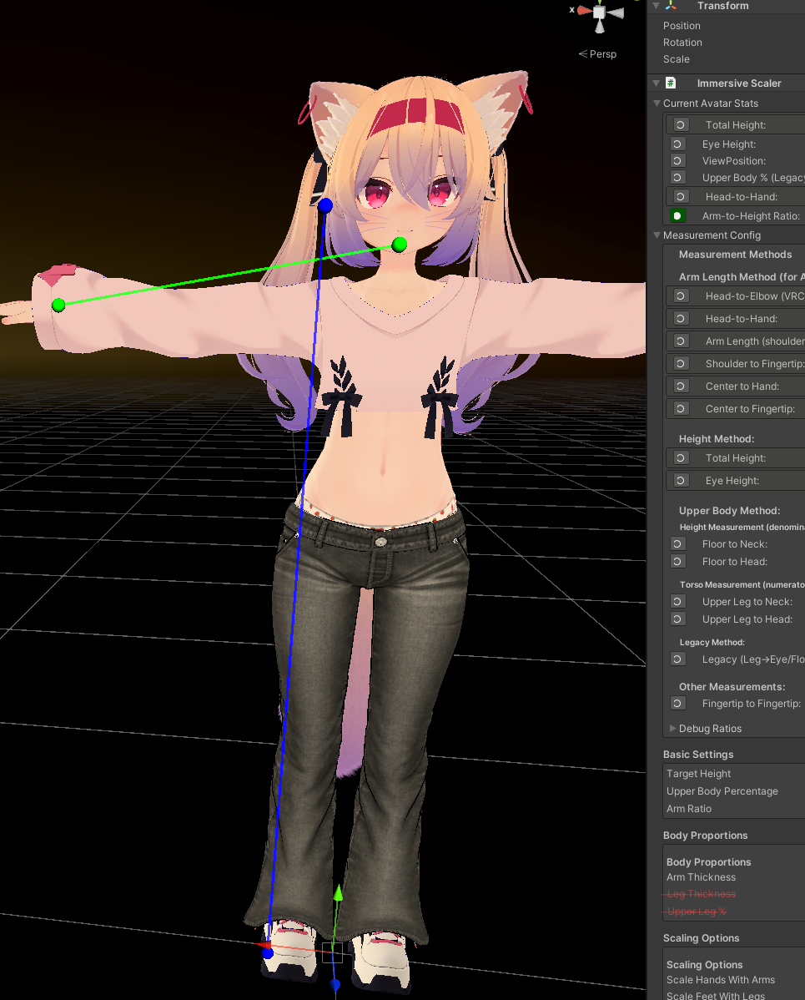
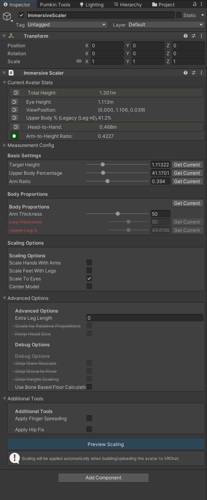
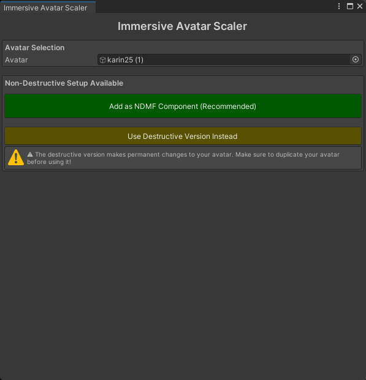
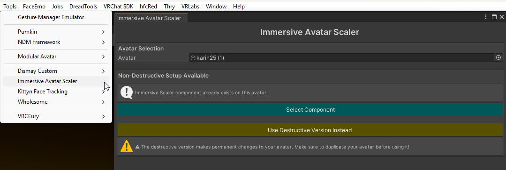

# VRChat Immersive Scaler

A Unity 2022 tool for scaling VRChat avatars to match real-world proportions while maintaining VR immersion. It uses NDMF for non-destructive build-time avatar modifications.

If you just want to scale your arms and legs, there's an easier way to do it in-game with Limb Scaler by nanochip:  https://x.com/xNanochip/status/1989030705850949650

Immersive Scaler also includes renderer-based measurement overrides and mesh outlier filtering for avatars with hidden props, bad bounds, or separate head/body meshes.

> **Note**: The exact IK measurement parameters VRChat uses internally are not fully documented. The current defaults are based on community research and testing. We'll update with firm defaults and bump the version once the exact parameters are confirmed.

[](https://vcc.docs.vrchat.com)
[](https://creators.vrchat.com/sdk/upgrade/current-unity-version/)
[](https://vcc.docs.vrchat.com/)
[](https://github.com/bdunderscore/ndmf)

## 🚀 Quick Install

Add to VCC with one click:

<a href="https://immersive-scaler.kittyn.cat/install">
  
</a>

Or manually add this URL to VCC:
```
https://immersive-scaler.kittyn.cat/index.json
```

## 📋 Features

### Core Scaling Features
- ✅ **Automated Avatar Scaling** - One-click scaling to match your real height
- ✅ **VRChat IK Compatibility** - Maintains proper VRChat IK measurements
- ✅ **Automatic ViewPosition** - Reconciles the final measured eye position after scaling
- ✅ **Non-Destructive** - Uses NDMF for build-time processing

### Customization Options
- 🎯 Upper body vs lower body ratio adjustment
- 🎯 Arm and leg thickness control
- 🎯 Thigh vs calf proportion tuning
- 🎯 Hand and foot scaling options
- 🎯 Custom VRChat arm ratio (IK arm length)

### Advanced Features
- 🔧 Multiple measurement methods (eye height, total height, various arm measurements)
- 🔧 Optional body/head renderer overrides for difficult mesh bounds
- 🔧 Visual measurement gizmos for debugging
- 🔧 Finger spreading for better controller tracking
- 🔧 Hip bone adjustment tool
- 🔧 Center avatar at origin
- 🔧 Automatic floor placement



*Visual measurement gizmos help you understand the scaling calculations*

## 📋 Requirements

- Unity 2022.3.22f1, matching the current VRChat target for this package
- VRChat SDK3 Avatars 3.10.3 or newer within the 3.10.x line
- [NDMF (Non-Destructive Modular Framework)](https://github.com/bdunderscore/ndmf) 1.13.0 or newer within the 1.x line
- Avatar with Humanoid rig configuration

## 🛠️ Usage

### Basic Setup
1. Add the **Immersive Scaler** component to your avatar
2. Click "Get Current" to populate values from your avatar
3. Adjust settings as needed
4. Use "Preview Scaling" to see changes
5. Upload your avatar - scaling is applied automatically!



*The Immersive Scaler component interface*

### Two Ways to Use

#### Method 1: NDMF Component (Recommended)
- Add the Immersive Scaler component to your avatar
- Non-destructive - original avatar is preserved
- Scaling applied during upload/build

#### Method 2: Tools Menu
- Go to Tools → Immersive Avatar Scaler
- Make permanent changes to your avatar
- Useful for testing and debugging



*The Tools window showing NDMF component option*



*Alert shown when component already exists on avatar*

[📖 Full Documentation](VRChatImmersiveScaler/README.md)

## 🔧 Troubleshooting

### Copy a diagnostic report

Expand **Debug** at the bottom of the Immersive Scaler inspector or Tools window, below the preview controls. Choose **Current state**, **Last preview**, or **Latest build (this Editor)**, then click **Copy Debug Report**. Current state is a read-only measurement snapshot; use **Refresh measurements** after changing the avatar outside the scaler UI.

Preview and build reports capture the inputs, actual scaling calculations, and resulting viewpoint. A preview report remains available after cancelling. The build report identifies its avatar and capture time and covers the Immersive Scaler NDMF pass; later build plugins may still change the avatar. Reports include package versions, measurement methods, renderer bounds and rejection decisions, bone fallbacks, scale factors, and viewpoint/eye offsets. The diagnostic text uses stable English labels for support; the panel controls are localized.

For a misplaced-viewpoint report, include the preview and build reports plus whether the issue appears in Unity preview, a built avatar, or VRChat. A deliberately offset viewpoint is preserved, so a nonzero eye offset alone does not prove an error.

### Common Issues

**Avatar shrinks unexpectedly**
- Click "Get Current" before making adjustments
- Ensure you're using the correct measurement methods
- Enable measurement renderer overrides if hidden props or bad mesh bounds affect stats

**Preview doesn't match final result**
- Make sure all bones are properly mapped
- Check that your avatar has a valid Humanoid configuration

**VCC can't find the package**
- Ensure you've added the repository URL correctly
- Try refreshing your package list in VCC

[📖 Full Troubleshooting Guide](VRChatImmersiveScaler/TROUBLESHOOTING.md)

## 🤝 Contributing

Contributions are welcome! Please read our contributing guidelines before submitting PRs.

1. Fork the repository
2. Create your feature branch (`git checkout -b feature/AmazingFeature`)
3. Commit your changes (`git commit -m 'Add some AmazingFeature'`)
4. Push to the branch (`git push origin feature/AmazingFeature`)
5. Open a Pull Request

## 📜 License

This project is licensed under the MIT License - see the LICENSE file for details.

## 🙏 Acknowledgments

- Inspired by the [Immersive Scaler Blender addon](https://github.com/Pager07/immersive_scaler) - mathematical concepts reimplemented for Unity
- NDMF framework by bd_ for non-destructive Unity modifications
- VRChat community for testing and feedback
- All contributors to the Immersive Scaler project

## 📞 Support

- **Issues**: [GitHub Issues](https://github.com/kittynXR/imscaler/issues)
- **Documentation**: [Full Documentation](VRChatImmersiveScaler/README.md)

---

Made with ❤️ for the VRChat community
